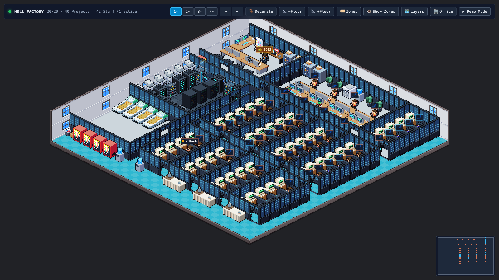
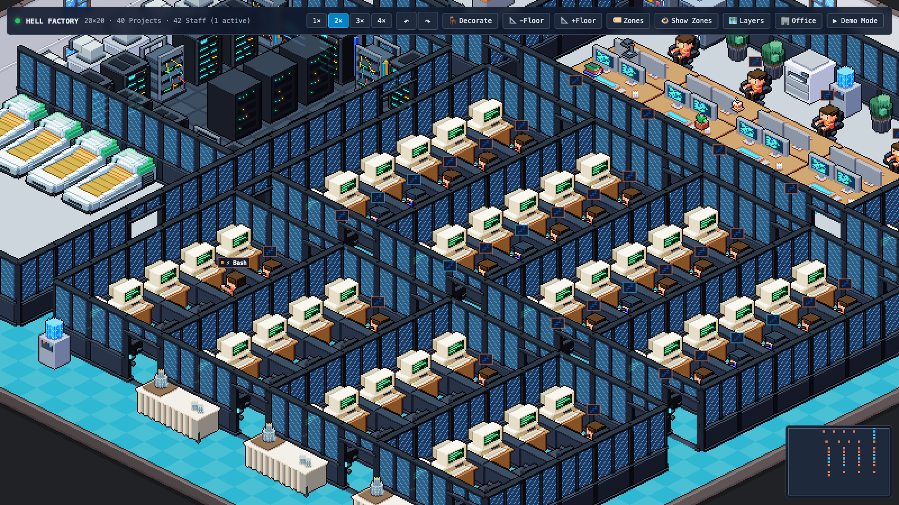
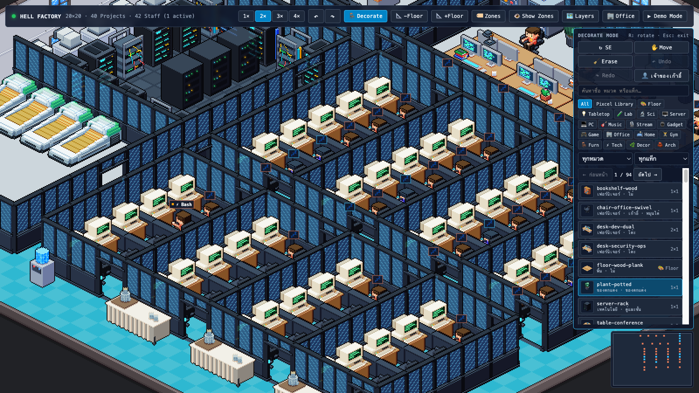
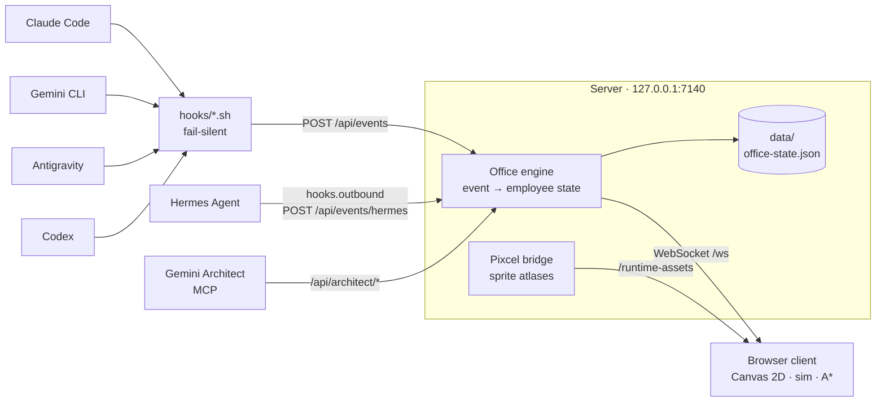

<div align="center">

# 🔥 IHERK Hell Factory

**A live isometric pixel-art office where your AI coding agents show up for work.**

ออฟฟิศพิกเซลอาร์ตแบบ isometric ที่แสดงการทำงานของ AI agent แบบสด ๆ




</div>

Every Claude Code, Gemini CLI, Antigravity, Codex and Hermes Agent session on this machine becomes an employee.
Prompts, tool calls, subagents and idle time drive where they walk and what they do: get a brief from
the Boss, sit down and type, gather at the meeting table, or doze at their desk.

It is a monitor, not a controller. It never starts or prompts an agent, and it runs on
`127.0.0.1` only.

## Highlights

| | |
|---|---|
| 🏢 **One office, every tool** | Claude Code, Gemini CLI, Antigravity and Codex report through small fail-silent hooks; Hermes Agent (chats, bots, cron and every subagent) through its outbound webhooks |
| 👥 **Teams per project folder** | Each folder you work in gets its own roster, name and colour; subagents join as temps |
| 🚶 **Agents that move** | A* pathfinding, six activity states, tool bubbles, glowing monitors |
| 🪑 **Decorate Mode** | Arrange furniture, assign seats and hang wall art, shelves and equipment with undo/redo |
| 🗺️ **Your floor plan** | Resize the floor, paint tiles, draw custom zones, move the Boss corner, export/import layouts |
| 🎨 **7,700+ pixel assets** | Starter assets, props and a searchable library of 7,594 items across 87 asset families |
| 🌗 **Three themes** | Office, Night and Day, plus 90° view rotation and 1–4× zoom |
| 🤖 **AI architect** | An MCP server lets Gemini (and only Gemini) rearrange furniture and craft new assets |

<table>
<tr>
<td width="50%"></td>
<td width="50%"></td>
</tr>
<tr>
<td align="center"><sub>Agents at their desks, with a live tool bubble</sub></td>
<td align="center"><sub>Decorate Mode and the furniture catalog</sub></td>
</tr>
</table>

[Watch the launch film in English](docs/video/hell-factory-promo-small.mp4) · [ชมวิดีโอแนะนำภาษาไทย](docs/video/hell-factory-promo-th-small.mp4)

## Quick start

**Requirements:** Node.js ≥ 22, plus `jq` and `curl` for the hooks. The sprite engine
[`iherk-pixcel`](https://github.com/pakornpong/iherk-pixcel) must sit next to this repo
(or set `IHERK_PIXCEL_ROOT`).

```bash
# 1. Build the sprite engine
git clone https://github.com/pakornpong/iherk-pixcel.git
cd iherk-pixcel && npm install && npm run build && cd ..

# 2. Build and start the office
git clone https://github.com/pakornpong/iherk-hell-factory.git
cd iherk-hell-factory && npm install && npm run build
npm start
```

Open **http://127.0.0.1:7140**. No agents running yet? Press **▶ Demo Mode** in the toolbar, or start with
`npm run dev -- --demo` to watch a scripted four-project day.

### Connect your AI tools

```bash
node dist/cli/index.js install-hooks --dry-run   # preview the changes
node dist/cli/index.js install-hooks             # Claude Code, Gemini CLI, Antigravity
node dist/cli/index.js install-codex-hooks       # Codex
node dist/cli/index.js install-hermes-hooks      # Hermes Agent (then restart the Hermes gateway/desktop app)
```

The shell hook installers back up settings files before changing them. The scripts run quietly
and time out after one second if Hell Factory is unavailable.

- **Codex** requires you to trust the installed Hell Factory hooks. In the desktop app, open
  **Settings → Hooks** or **Review hooks**. In the CLI, use `/hooks`. Review entries that run
  `hooks/codex-hook.sh`, then send a new prompt after trusting them.
- **Hermes Agent** must have the `hermes` CLI on your PATH. The installer adds a webhook to
  `hooks.outbound` and preserves other targets. Use `--profile NAME` for a named profile and
  `--port PORT` when Hell Factory runs on a different port. Open a new Hermes CLI session or
  restart the Hermes gateway or desktop app to load the change.

### Dev and production

There is one process and one port in both modes. The server serves the client bundle itself, so
there is no separate dev server.

| | Dev | Production |
|---|---|---|
| Command | `npm run dev` (`tsx`, no server build) | `npm run build` then `npm start` |
| URL | http://127.0.0.1:7140 | http://127.0.0.1:7140 |
| Client bundle | `npm run build:client` after editing `src/client` | built by `npm run build` |
| State | `data/office-state.json` | same file |

## How it works



### What the agents do

| State | Triggered by | On screen |
|---|---|---|
| `assigning` | A new prompt, or a subagent being spawned | Walks to the Boss desk for the brief |
| `working` | Tool calls | Sits at a desk and types, with a tool bubble |
| `teamwork` | Two or more agents working in the same project | The team works side by side |
| `meeting` | Planning and brainstorming tools | Gathers at the meeting table |
| `reporting` | A finished turn, or a question for you | Stands in front of the Boss desk |
| `resting` | 15 seconds after a turn ends | Dozes at its own desk 💤 |

## Controls

| Input | Action |
|---|---|
| Drag / scroll | Pan / zoom |
| `1` – `4` | Set the zoom level |
| `[` `]` | Rotate the view 90° |
| `R` | Rotate the selected furniture (Decorate Mode) |
| `Z` | Toggle the zone editor |
| `L` | Cycle overlays: tile permissions → render layers → off |
| `Cmd/Ctrl + Z` | Undo in Decorate Mode (add `Shift` to redo) |
| `Esc` | Leave the current mode |

### Mount items on a wall or divider

Open **Decorate → ติดผนัง** to browse 200 mountable items, including artwork, signs, shelves
and electronics. Select an item, move the pointer left or right and up or down on a solid
wall or supported divider face, then click to place it. The preview follows the pointer and
shows where the item will sit.

Use **Move** to reposition an existing item. Multiple items fit on the same face when they
stay within the surface and do not overlap. Attachments move with their divider and retain
their placement in exported layouts.

[Wall decoration previews](assets/pixcel/library/mounted-decor/001/preview.png) · [Shelf previews](assets/pixcel/library/mounted-equipment/003/preview.png)

## CLI

```text
hell-factory start [--port 7140] [--demo] [--no-watch-antigravity]
hell-factory demo [--port 7140]
hell-factory mcp [--port 7140]
hell-factory build-assets
hell-factory install-hooks [--dry-run] [--with-mcp]
hell-factory install-codex-hooks [--dry-run]
hell-factory install-hermes-hooks [--dry-run] [--profile NAME] [--port 7140]
hell-factory install-mcp [--dry-run]
```

Run it as `node dist/cli/index.js <command>`, or `npm run dev -- <flags>` for `start`.

| Variable | Default | Purpose |
|---|---|---|
| `HELL_FACTORY_PORT` | `7140` | HTTP and WebSocket port |
| `HELL_FACTORY_ROOT` | repo root | Where `data/`, `public/` and `runtime-assets/` live |
| `IHERK_PIXCEL_ROOT` | `../iherk-pixcel` | Sprite engine location |
| `HELL_FACTORY_WATCH_AGY` | on | Set to `0` to stop tailing Antigravity transcripts |
| `HELL_FACTORY_URL` | `http://127.0.0.1:7140` | Where the hooks send events |

## Gemini Architect (MCP)

`install-hooks --with-mcp` (or `install-mcp`) registers a stdio MCP server for Gemini with these tools:
`get_office_state`, `list_furniture_catalog`, `place_furniture`, `move_furniture`, `remove_furniture`,
`craft_furniture_asset`, `manage_bay`, `set_tile_permission`, `expand_floor`.

Layout changes go through `/api/architect/*`, which needs the token in `data/architect.token`
(`x-architect-token` header) or a local UI session. Telemetry hooks can only post events, so a
Claude or Codex session cannot move your furniture.

## Project layout

```text
src/
  cli/        start, demo, mcp, build-assets, hook installers
  server/     HTTP + WS, office engine, layout engine, pixcel bridge, demo simulator
  client/     Canvas renderer, simulation, camera, Decorate Mode, HUD
  mcp/        Gemini Architect MCP server
  shared/     Zod schemas, tile permissions, render layers
hooks/        Telemetry hook scripts, one per tool
assets/pixcel/  Props, characters and the generated asset library
scripts/      Client build, asset-library generators, local LLM prop forge
tests/        Vitest suites
docs/         Design specs and the as-built architecture
```

| Script | What it does |
|---|---|
| `npm run build` | Server, client bundle and core sprite atlases |
| `npm run dev` | Start from source with `tsx` |
| `npm test` | Run the Vitest suites |
| `npm run typecheck` | Type-check server and client |
| `npm run assets:check-footprints` | Check for library assets whose declared footprints exceed their voxel bounds |

## Documentation

- [Architecture as built](docs/superpowers/specs/2026-11-26-architecture-as-built.md) — current module map, HTTP API, routing rules and known issues
- [Original design](docs/superpowers/specs/2026-11-24-iherk-hell-factory-design.md) — intent, goals and the telemetry model
- [Open floor and zones](docs/superpowers/specs/2026-11-25-open-floor-hypersleep-zones.md) · [Layers and Decorate Mode](docs/superpowers/specs/2026-11-24-layer-permissions-and-decorate.md) · [Edge walls](docs/superpowers/specs/2026-11-24-flush-rooms-edge-walls.md)
